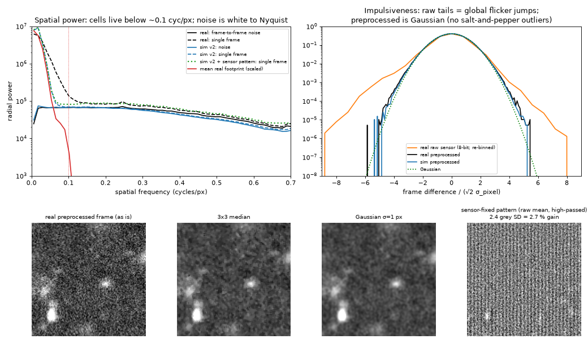
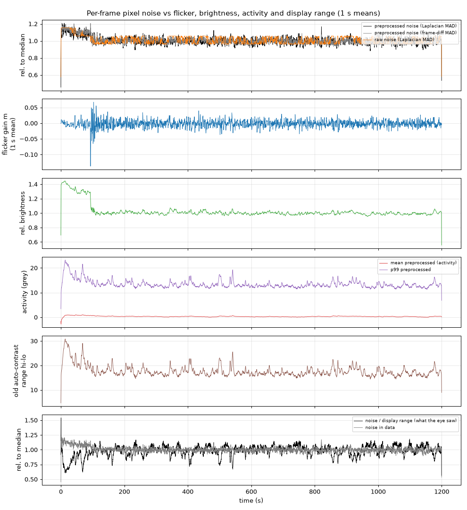

# Pixel noise in the preprocessed video (Nov 2026)

The PI saw two things in the app's "preprocessed" panel on the workshop CA1
recording (600x600, 23 711 frames, 19.76 fps, 20 min):

- **(A)** a lot of fine, salt-and-pepper-looking noise; can it be filtered
  without hurting what we care about?
- **(B)** the noise seems to grow and shrink in waves. Is that the flicker
  correction, or something else?

Everything below is measured with `crates/cala/examples/pixnoise_eval.rs`
(per-frame noise, flicker, brightness, activity and display-range statistics,
plus a 192x192 centre crop of frames 1000-3999 in sensor and tissue
coordinates; full chain with motion correction). The analysis scripts are in
the session scratchpad (`pixnoise/`). Peak RAM was 0.6 GB.

## (A) What the fine noise is



**It is ordinary white pixel noise, mostly shot noise.** In the preprocessed
frames it is Gaussian.

- Per-pixel σ (frame-difference MAD) is 3.0 grey levels; the sims give 2.85.
- Raw noise follows a shot-noise law, `σ² = 0.169·mean + 3.3`. At the typical
  brightness of 51 grey levels, about 70 % of the variance is shot noise.
- Standardized frame differences have an excess kurtosis of 0.16 (sim 0.09).
  About 7 pixels per million exceed 5σ, roughly two pixels in a 600x600 frame.
- Those few outliers are spatially isolated: none of them has an outlying
  4-neighbour.
- So there is no impulsive (salt-and-pepper) component to remove. Hot pixels
  are already repaired upstream.

**The raw sensor frames do have heavy tails, but they are flicker, not pixel
impulses.** Raw differences show 1.2e-3 of pixels beyond 5σ and a kurtosis
of 1.8.

- 92 % of those outliers fall in 1 % of the frames.
- Those frames are the LED gain jumps (|Δm| up to 0.25 per frame around the
  ~92 s brightness step); r(outlier fraction, |Δm|) = 0.69.
- The flicker stage removes all of them. The same frames have no outliers
  after preprocessing.

**Spatial scale: cells and noise barely overlap.**

- Real discovered footprints have a median HWHM of 5.4 px (half-max
  diameter 10 px).
- The mean footprint's power is down to 1 % of DC at 0.06 cycles/px and to
  0.1 % at 0.10 cycles/px. That is the effective optical / scatter cutoff for
  cell signal.
- The noise is white up to about 0.25 cycles/px. Above that the motion
  correction's bicubic resampling rolls it off.
- So about 95 % of the noise variance in a pixel lies at spatial frequencies
  where cells have no signal. That is why the frame looks grainy while traces
  are clean: a footprint projection is already a matched spatial filter over
  ~80-160 pixels.

**A second, smaller component: a sensor-fixed pixel pattern (new finding).**

- The high-passed temporal mean in **sensor** coordinates has a pattern of
  2.4 grey levels SD, 2.7 % of brightness. Its split-half correlation is 0.994,
  so it is static.
- It is multiplicative: its relative size is constant across brightness, which
  makes it PRNU-like (photo-response non-uniformity).
- About 23 % of its variance is column structure, with a negative lag-2 column
  correlation (the vertical stripes in the last panel above).
- In **tissue** coordinates, after motion correction, its static part drops to
  0.45 grey levels. The rest becomes a motion-driven, temporally correlated
  shimmer: single frames carry 21 % more power than the frame-difference noise
  at 0.15-0.45 cycles/px, and 100-frame means keep 10 % of the noise power
  where white noise would keep 1 %.
- The frame-difference noise estimator does not see this shimmer.
- minisim's v2 calibration had none of it (0.19 grey levels, +4 %).

**Sim calibration.** The pattern is reproduced by spec parameters alone: a
`sensor_defects` step with `prnu_sd = 0.024` and `column_fpn_sd = 1.0`, plus
the default hot pixels. That sim reads 2.19 grey levels with a split-half
correlation of 0.998, a static part of 0.36 in tissue coordinates, +22 %
high-frequency excess, 0.086 slow, and per-pixel σ 3.03. All of these match
the real data. See `ca1_workshop_v2_fpn.spec.json` notes below.

## (B) The waves



Per-frame noise in the data (Laplacian-residual MAD and frame-difference MAD
inside the eroded FOV) against flicker, brightness, activity and the old
auto-contrast range, all as 1 s means:

| quantity (1 s means) | CV | p95/p5 |
|---|---|---|
| noise in the preprocessed data | 3.8 % | 1.13 |
| old auto-contrast range (0.5-99.5 % quantiles, EMA 0.3) | 13 % | 1.42 |
| noise / display range (what the eye saw) | 9 % | 1.36 |

- **The waves are mostly display.** About 90 % of the variance of log(noise ÷
  range) comes from the range: var 0.0133 for log range against 0.0014 for
  log noise.
- Apparent noise anti-correlates with population activity: r = -0.91 with the
  p99 of the frame and -0.92 with the range.
- The range has 65 % of its power at 0.02-0.2 Hz, the population bursts every
  ~25 s.
- During a burst the bright cells widen the auto-contrast range, so the same
  noise looks smaller; between bursts the range shrinks and the grain looks
  bigger.
- Auto-contrast is being removed from every view in a separate change, which
  removes these waves.

**The data's own noise varies a little, with brightness, not with the flicker
correction.**

- r(noise, raw brightness) = 0.69. The noise follows shot noise:
  r(noise, raw noise) = 0.44, and the raw-noise law above.
- r(noise, flicker gain m) = -0.20. The gain m has an SD of only 2.3 %, so
  dividing by (1+m) moves the noise by about 2 %.
- In the ~20 s after the 92 s step, the LED gain jumps by ±25 % from frame to
  frame and the flicker stage corrects it. The preprocessed noise shows no
  matching jumps.
- The brightness step itself lowers the noise by 10-12 % (fewer photons). The
  streaming noise map follows it within its ~30 s time constant.
- Frames in the top 10 % of activity are 7-8 % noisier than below-median
  frames, from the extra photons of the active cells.
- 1 s noise relative to the trailing 30 s median: p1-p99 = 0.93-1.07.

**Decision: (B) is display. The real part is small (±5 %), slow and
brightness-driven, and the noise map already follows it. A time-varying
noise scale is not warranted.** The add, keep and merge tests are also
self-calibrating: their χ² is measured in units of the variance the current
model leaves in the patch.

## (A, continued) Does filtering help? Ground-truth tests

The arms are applied to every registered frame before the background, noise,
fast-loop and slow-loop stages. They are diagnostic environment switches in
the eval harness (`crates/cala/examples/common/prefilter.rs`):

- `CALA_PREFILTER=median3`: 3x3 median;
- `CALA_PREFILTER=gauss1`: normalised Gaussian, σ = 1 px (also tried at
  σ = 0.7 and σ = 2);
- `CALA_FLATFIELD=1`: a sensor-coordinate gain map from the warm-up mean,
  `mean / median5(mean)`, divided out before flicker / motion. This is the
  better-motivated arm against the sensor pattern.

**Trace fit with oracle footprints.** `trace_eval`, v2 sim with no motion,
4000 frames, 606 cells, rank-5 background. The `fp` arms blur the oracle
footprints with the same Gaussian, a consistent model.

| arm | r median | r p10 | crosstalk p90 | close pairs <12 px (n=344): r / crosstalk p90 | <18 px (n=502): crosstalk p90 |
|---|---|---|---|---|---|
| none | **0.949** | **0.697** | **0.141** | **0.946** / **0.144** | **0.154** |
| median3 | 0.945 | 0.684 | 0.145 | 0.942 / 0.153 | 0.156 |
| gauss1 (data only) | 0.948 | 0.694 | 0.152 | 0.946 / 0.168 | 0.166 |
| gauss1 + footprints | 0.948 | 0.693 | 0.149 | 0.946 / 0.153 | 0.160 |
| gauss0.7 + footprints | 0.949 | 0.696 | 0.145 | 0.946 / 0.152 | 0.157 |
| gauss2 + footprints | 0.944 | 0.678 | 0.165 | 0.943 / 0.171 | 0.175 |

No filter is best or tied on every column. Close-pair crosstalk gets worse
with every filter. That is expected: with white noise, least squares on the
unfiltered pixels is already the best linear estimate (Gauss-Markov), and the
footprint projection is the matched spatial filter.

**Discovery end to end.** `discover_eval`, 480 s sims (9600 frames). The
sims are v2 seed 5, v2 seed 6, v2 + rigid motion (`v2r`), and v2r + the
measured sensor pattern (`fpn`, the same seed as v2r). Trace r is the pass-2
r of matched cells. ρ is the noise-correlation inflation that `noise_corr`
measures and applies to every null.

| sim | arm | precision | recall (all) | recall (in focus) | recall @ 2400 frames | trace r | ρ |
|---|---|---|---|---|---|---|---|
| v2 s5 | none | 0.976 | 0.754 | 0.908 | **0.573** | 0.962 | 1.00 |
| | median3 | 0.976 | 0.733 | 0.896 | 0.525 | 0.962 | 6.70 |
| | gauss1 | 0.985 | 0.766 | 0.913 | 0.541 | 0.965 | 9.60 |
| v2 s6 | none | 0.959 | **0.782** | **0.867** | **0.583** | 0.963 | 1.00 |
| | gauss0.7 | 0.957 | 0.776 | 0.879 | 0.547 | 0.966 | 5.46 |
| | gauss1 | 0.960 | 0.765 | 0.830 | 0.529 | 0.965 | 9.60 |
| v2r (motion) | none | 0.932 | **0.741** | **0.843** | **0.546** | 0.963 | 1.51 |
| | median3 | 0.953 | 0.723 | 0.820 | 0.491 | 0.966 | 7.22 |
| | gauss1 | 0.951 | 0.723 | 0.814 | 0.506 | 0.965 | 9.84 |
| fpn (motion + pattern) | none | 0.953 | **0.736** | **0.820** | **0.527** | 0.963 | 1.40 |
| | flat field | 0.945 | 0.733 | 0.814 | 0.522 | 0.964 | 1.50 |
| | median3 | 0.944 | 0.725 | 0.791 | 0.494 | 0.964 | 7.00 |
| | gauss1 | 0.962 | 0.707 | 0.814 | 0.506 | 0.965 | 9.73 |

Recall by peak-SNR bin is left out: those SNRs are measured against the
filtered noise map, so they are not comparable across arms.

- Every spatial filter makes discovery **slower**. At 2400 frames, recall is
  3-5 points lower in every sim.
- Final recall is lower in 3 of 4 sims, by 1-3 points; the single gain is
  seed 5, +1.2 points, which seed 6 reverses.
- Precision gains of 1-2 points on the motion sims come from fewer adds
  overall, not better ones.
- Pass-2 trace r moves by +0.002-0.003, inside run-to-run noise. The oracle
  test above shows no gain.
- `noise_corr` does its job: the filters make the noise spatially correlated
  (ρ 5-10 against 1.0-1.5), the nulls widen accordingly, and precision does
  not collapse. But the filter removes nothing that the cell-scale blur
  inside discovery (block-average 2x2, then blur to cell scale) did not
  already remove.
- The flat field does not help. The sensor pattern does not hurt discovery
  either: fpn vs v2r, same seed and motion, is 0.953 / 0.736 against
  0.932 / 0.741.

## Decision

- **No pre-trace or pre-discovery spatial filter.** The fine grain is white,
  Gaussian shot and read noise at spatial frequencies where cells have no
  signal. The trace fit and discovery already integrate over cell-sized
  regions; extra filtering only costs demixing and early recall.
- **No time-varying noise scale.** The real noise moves ±5 % with
  brightness, not with the flicker correction, and the noise map already
  tracks it.
- **No flat-field stage.** The sensor-fixed pattern is real (2.7 %) and the
  sims now reproduce it, but correcting it changes nothing measurable.
- **Display.** The waves were the per-frame auto-contrast. That is handled by
  removing auto-contrast in a separate change. If the grain itself bothers
  people visually, a display-only σ ≈ 1 px blur is harmless, because it would
  not feed the pipeline.

## Caveats

- One seed per sim condition, except v2 (two seeds). The differences in
  final recall are of the order of seed-to-seed noise; the early-recall and
  crosstalk effects are consistent in sign everywhere.
- The sims' discovered footprints are about 30 % wider than real ones (HWHM
  7.1 against 5.4 px). Smaller real cells make blurring more harmful, not
  less, so the conclusion should hold.
- No real-data A/B was run for the filters; real data has no ground truth for
  recall.

## Reproduce

```sh
cargo build --manifest-path crates/cala/Cargo.toml --release --examples
B=crates/cala/target/release/examples
$B/pixnoise_eval real <raw dir> <out> --motion --fps 19.762756882076214 --crop 1000 4000 192 --full-every 100
CALA_PREFILTER=gauss1 $B/trace_eval <sim> <out> --frames 4000 --fp full --bg rank5   # (+ CALA_PREFILTER_FP=1)
CALA_PREFILTER=median3 $B/discover_eval sim <sim> <out> [--motion]
CALA_FLATFIELD=1 $B/discover_eval sim <sim> <out> --motion
```

Sims are rendered from `tools/minisim-calibration/ca1_workshop_v2.spec.json`
or `ca1_workshop_v2_fpn.spec.json` (480 s, seeds 5 and 6, rigid motion for
v2r and fpn).
